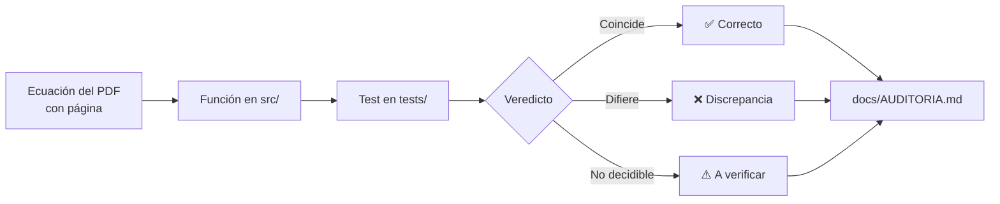

# cergneux-audit ⏱️

[](LICENSE)
[](https://www.python.org/)
[](https://github.com/amurlaniakea/cergneux-audit-demo/actions/workflows/ci.yml)

> **Demo / prototipo: v0.1, en desarrollo**

---

## Tabla de contenidos

- [Qué es y por qué existe](#qué-es-y-por-qué-existe)
- [Qué se puede aprender aquí](#qué-se-puede-aprender-aquí)
- [Inicio rápido](#inicio-rápido)
- [Visualizadores](#visualizadores)
- [Resultados de la auditoría](#resultados-de-la-auditoría)
- [Cómo leer un test como evidencia](#cómo-leer-un-test-como-evidencia)
- [Limitaciones](#limitaciones)
- [Hoja de ruta](#hoja-de-ruta)
- [Referencias](#referencias)
- [Licencia y créditos](#licencia-y-créditos)

---

## Qué es y por qué existe

Este repositorio es una **auditoría ejecutable** de dos documentos de Ricardo J. Cergneux:

1. **Teoría del Tiempo Cuántico** (enero 2025)
2. **Reinterpretación del efecto túnel cuántico a escala macroscópica** (diciembre 2025)

El repo **no valida ni refuta** la teoría. Su propósito es docente: cada ecuación del PDF se implementa como una función con su número de página, y cada afirmación cuantitativa tiene un test que la contrasta con la física estándar. Los resultados —incluidos los que revelan discrepancias— quedan en el repositorio como evidencia reproducible.

> **Valor docente**: aprender a contrastar una propuesta teórica usando sus propias ecuaciones como punto de partida, sin recurrir a la autoridad ni al escepticismo previo.



---

## Qué se puede aprender aquí

| Tema | Módulo | Qué contrasta |
|------|--------|---------------|
| **Leyes del Tiempo, Fotón y Luz** | `laws.py` | Identidad $L_p/T_p = c$, aritmética de Mercurio, ticks por segundo |
| **Cosmología: $r_s$ vs $c/H_0$, supernovas, emisividad** | `cosmology.py` | Radio de Schwarzschild de la masa crítica, estiramiento $(1+z)$, Ley de la Fila, energía por bandas |
| **Unión Josephson: transmon, washboard, túnel** | `josephson.py` | Niveles transmon, potencial washboard, tasa de escape térmica/cuántica, predicción $T_2$ |
| **TDSE: paquete de ondas contra barrera** | `tdse.py` | Split-step Fourier, transmisión analítica rectangular |

**Conceptos clave** que aparecen en el código y los tests:
- Dilatación temporal y desplazamiento al rojo
- Túnel macroscópico y potencial *washboard*
- Qubit *transmon* y disipación (DMC 1985)
- Método *split-step Fourier* para la ecuación de Schrödinger dependiente del tiempo

---

## Inicio rápido

```bash
# 1. Clonar y entrar
git clone https://github.com/amurlaniakea/cergneux-audit-demo.git
cd cergneux-audit-demo

# 2. Entorno virtual e instalación editable
python3 -m venv .venv
source .venv/bin/activate
pip install -e ".[dev]"

# 3. Ejecutar la suite de tests
pytest -q
# todos pasan (test_real_data_exponent se omite si no hay data/sn_stretch.csv)
```

> **Requisitos**: Python ≥ 3.9, `numpy`. Sin dependencias de red ni servicios externos.

---

## Visualizadores

Dos páginas HTML autocontenidas (sin dependencias, se abren directamente en el navegador):

| Visualizador | Qué muestra | Qué mover |
|--------------|-------------|-----------|
| [`viz/josephson.html`](https://amurlaniakea.github.io/cergneux-audit-demo/viz/josephson.html) | Potencial *washboard*, barrera $\Delta U$, frecuencia de plasma $\omega_p$, tasa de escape térmica vs. cuántica, y la predicción de $T_2$ del Test 1 contra la escala real de un *transmon* | Sesgo $I/I_0$, corriente crítica $I_0$, capacitancia $C$, factor de calidad $Q$, frecuencia del qubit $f_{01}$ |
| [`viz/redshift.html`](https://amurlaniakea.github.io/cergneux-audit-demo/viz/redshift.html) | Tres paneles: (1) duración observada de supernovas Ia: estándar $(1+z)$ vs. Ley de la Fila $1/(1+z)$; (2) $(r-r_s)/r_s$ en escala log para un $\rho = 1+z$ dado; (3) emisividad efectiva $\rho^4$ si se conserva la energía por bandas | $\rho = 1+z$ (panel 2 y 3) |

> **Nota**: Los visualizadores no se renderizan en la vista de GitHub. Los enlaces arriba apuntan a **GitHub Pages** (rama `main`, raíz del repo). Si el enlace no funciona, abre el archivo local `viz/josephson.html` o `viz/redshift.html` en tu navegador.

---

## Resultados de la auditoría

Tabla resumida (fuente: [`docs/AUDITORIA.md`](docs/AUDITORIA.md)):

| # | Afirmación (página) | Resultado | Test |
|---|---------------------|-----------|------|
| 1 | $c = L_p/T_p$ confirma el movimiento cuántico (TC p. 5) | Identidad por definición; no confirma nada | `test_planck_speed_is_c_by_construction` |
| 2 | $1/T_p \approx 1.85487\times10^{43}$ (TC p. 6) | Correcto | `test_ticks_per_second_matches_paper` |
| 3 | Gemelos: $T_1 = \gamma T_2$ (TC pp. 12-14) | Correcto; es dilatación estándar con otra notación | `test_twin_gamma_two` |
| 4 | CMB en $r = r_s$, $\rho \to \infty$ (TC pp. 32, 48) | Un $\rho$ pequeño exige $r \gg r_s$; no hay regla distancia→$r$ | `test_small_redshift_needs_r_far_beyond_rs` |
| 5 | $r_s$ de la masa bariónica = radio del universo observable (TC p. 43) | Identidad: $r_s$ de la masa crítica en la esfera de Hubble es $c/H_0$ | `test_rs_equals_hubble_radius_is_an_identity` |
| 6 | Mercurio: 28,8 km por dilatación temporal (TC pp. 37-38) | La dilatación da ~8 km; 28,8 km es el desfase geométrico de la precesión de la RG | `test_mercury_paper_shift_is_the_precession_not_the_dilation` |
| 7 | Supernovas más lejanas duran menos (TC pp. 46-47) | **Opuesto** al estiramiento $(1+z)$ medido; verificar con datos | `test_sn_stretch_directions_are_opposite` |
| 8 | Ley de la Energía: $\rho$ fotones por cada fotón emitido (TC pp. 30-31) | Aplicada a un cuerpo negro da emisividad $\rho^4$; FIRAS mide 1 | `test_energy_conservation_claim_gives_rho4_emissivity` |
| 9 | $\Delta D$ constante (TC p. 10) y $\Delta D$ decreciente (TC p. 51) | Contradicción interna del texto | (documental) |
| 10 | $dn/dt = (E_J \sin\phi + F)/\hbar$ (Túnel §4.1) | Signo incorrecto: $(F - E_J \sin\phi)/\hbar$ | `test_hamilton_sign_error_in_paper` |
| 11 | «$n$ entero ⇒ $\phi$ discreta» (Túnel §3.3) | $n$ entero implica $\phi$ periódica, no discreta | (documental) |
| 12 | Meseta de la tasa de escape a baja $T$ prueba tiempo discreto (Túnel §7) | La explica el túnel con disipación (DMC 1985) | `test_mqt_plateau_below_crossover_without_discrete_time` |
| 13 | Test 1: $T_2 \sim \tau_p\cdot2\pi/(\Delta E/\hbar)$ (Túnel §12) | $\sim 10^{-53}$ s frente a $\sim 10^{-4}$ s medidos | `test_cergneux_t2_prediction_is_absurdly_short` |
| 14 | Túnel = salto discreto sin trayectoria continua (TC p. 55, Túnel §7) | El TDSE continuo reproduce la transmisión analítica | `test_wavepacket_transmission_matches_analytic` |

---

## Cómo leer un test como evidencia

Ejemplo literal: **test_hamilton_sign_error_in_paper** (`tests/test_josephson.py`)

```python
def test_hamilton_sign_error_in_paper():
    phi, ej, f, h = 0.3, 1.0, 0.2, 1e-6
    energy = lambda p: -ej * np.cos(p) - f * p                      # parte de H que depende de φ
    exact = -(energy(phi + h) - energy(phi - h)) / (2 * h)           # −∂H/∂φ numérico (ħ = 1)
    assert j.dn_dt_standard(phi, ej, f, hbar=1) == pytest.approx(exact, rel=1e-6)
    assert j.dn_dt_paper(phi, ej, f, hbar=1) != pytest.approx(exact, rel=1e-6)
    # sin sesgo (F = 0) el PDF da exactamente el signo contrario
    std0, paper0 = j.dn_dt_standard(phi, ej, 0.0, hbar=1), j.dn_dt_paper(phi, ej, 0.0, hbar=1)
    assert std0 < 0 < paper0
    assert paper0 == pytest.approx(-std0)
```

**Qué hacen los asserts reales**:
1. La versión estándar coincide con $-\partial H/\partial\phi$ calculado por **derivada numérica**, independiente de la fórmula escrita en el código.
2. La versión del PDF **no** coincide con esa derivada.
3. Sin sesgo ($F=0$) la del PDF tiene exactamente el signo contrario. El PDF contradice así su propia ecuación $dn/dt = -\frac{1}{\hbar}\partial H/\partial\phi$.

**Claves para leer cualquier test del repo**:
1. **Parámetros adimensionales** → el test usa $\phi, E_J, F$ normalizados ($\hbar=1$); la física está en la estructura, no en las unidades.
2. **Asserts explícitos** → igualdad/desigualdad con `pytest.approx` o rangos declarados en el propio test (algunos usan umbrales, p. ej. Mercurio o T₂); léelos antes de fiarte del veredicto.
3. **Nombre del test** → describe el veredicto (`*_sign_error_*`, `*_is_absurdly_short`, `*_matches_analytic`).

---

## Limitaciones

- **Estiramiento de supernovas**: el test `test_sn_stretch_directions_are_opposite` muestra que la Ley de la Fila ($1/(1+z)$) predice lo opuesto a lo medido ($(1+z)$), pero **no se ha contrastado con datos reales (Pantheon+)**. Está marcado como *a verificar con datos*.
- **Alcance**: es una **demo/prototipo (v0.1)**, no una refutación completa. Solo cubre las ecuaciones y afirmaciones que se pudieron mapear a código comprobable.
- **Fuentes**: los PDFs originales **no se incluyen** en el repo (son obra de su autor); solo se citan con número de página.

---

## Hoja de ruta

- [ ] Retícula discreta tipo Planck para el paquete de ondas (dispersión y violación de Lorentz).
- [ ] Contrastar el estiramiento de supernovas con datos reales (Pantheon+ / Union3).
- [ ] Contactar al autor para discutir los veredictos documentados.
- [ ] Añadir visualizador para la precesión de Mercurio (dilatación vs. precesión geométrica).

---

## Referencias

Solo se citan las que se pueden comprobar directamente en el código o en la literatura:

| Referencia | Uso en el repo |
|------------|----------------|
| **Devoret, Martinis, Clarke (1985)** — *Phys. Rev. Lett.* **55**, 1908 | Tasa de escape con disipación, potencial washboard, meseta cuántica |
| **Koch et al. (2007)** — *Phys. Rev. A* **76**, 042319 | Hamiltoniano *transmon*, niveles $E_n$, carga $E_C$ |
| **Goldhaber et al. (2001)** — *Astrophys. J.* **558**, 359 | Estiramiento temporal de supernovas Ia $\propto (1+z)$ |
| **Blondin et al. (2008)** — *Astrophys. J.* **682**, 724 | Confirmación del estiramiento $(1+z)$ en curvas de luz |

> **Nota**: Si una referencia no se puede comprobar en el código o en la literatura accesible, se ha omitido intencionadamente. No se inventan DOIs.

---

## Licencia y créditos

- **Código**: licenciado bajo **AGPL-3.0-or-later** — ver [`LICENSE`](LICENSE).
- **Copyright**: © 2026 **Pedro Sordo Martínez** — autor del código de auditoría, tests y visualizadores.
- **Ideas y ecuaciones de los PDFs**: pertenecen a **Ricardo J. Cergneux**; este repo solo las cita con página y las contrasta.

**Contacto**: **Pedro Sordo Martínez** — amurlaniakea@gmail.com

---