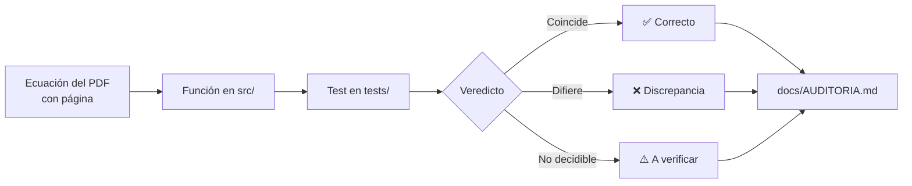

# cergneux-audit ⏱️

[](LICENSE)
[](https://www.python.org/)
[](https://github.com/amurlaniakea/cergneux-audit-demo/actions/workflows/ci.yml)

> **Demo / prototipo: v0.1, en desarrollo**

---

## Tabla de contenidos

- [Qué es y por qué existe](#qué-es-y-por-qué-existe)
- [Qué se puede aprender aquí](#qué-se-puede-aprender-aquí)
- [Inicio rápido](#inicio-rápido)
- [Visualizadores](#visualizadores)
- [Resultados de la auditoría](#resultados-de-la-auditoría)
- [Cómo leer un test como evidencia](#cómo-leer-un-test-como-evidencia)
- [Limitaciones](#limitaciones)
- [Hoja de ruta](#hoja-de-ruta)
- [Referencias](#referencias)
- [Cómo citar](#cómo-citar)
- [Cómo contribuir](#cómo-contribuir)
- [Licencia y créditos](#licencia-y-créditos)

---

## Qué es y por qué existe

Este repositorio es una **auditoría ejecutable** de dos documentos de Ricardo J. Cergneux:

1. **Teoría del Tiempo Cuántico** (enero 2025)
2. **Reinterpretación del efecto túnel cuántico a escala macroscópica** (diciembre 2025)

El repo **no valida ni refuta** la teoría. Su propósito es docente: cada ecuación del PDF se implementa como una función con su número de página, y cada afirmación cuantitativa tiene un test que la contrasta con la física estándar. Los resultados —incluidos los que revelan discrepancias— quedan en el repositorio como evidencia reproducible.

> **Valor docente**: aprender a contrastar una propuesta teórica usando sus propias ecuaciones como punto de partida, sin recurrir a la autoridad ni al escepticismo previo.



---

## Qué se puede aprender aquí

| Tema | Módulo | Qué contrasta |
|------|--------|---------------|
| **Leyes del Tiempo, Fotón y Luz** | `laws.py` | Identidad $L_p/T_p = c$, aritmética de Mercurio, ticks por segundo |
| **Cosmología: $r_s$ vs $c/H_0$, supernovas, emisividad** | `cosmology.py` | Radio de Schwarzschild de la masa crítica, estiramiento $(1+z)$, Ley de la Fila, energía por bandas |
| **Unión Josephson: transmon, washboard, túnel** | `josephson.py` | Niveles transmon, potencial washboard, tasa de escape térmica/cuántica, predicción $T_2$ |
| **Retícula discreta de Planck** | `lattice.py` | Paseo cuántico 1D: velocidad exacta de la luz, dispersión ω(k) y violación de Lorentz ∝ (E/E_P)² |
| **Retícula cúbica 3D y cotas** | `lattice3d.py` | Anisotropía de la luz en retícula cúbica y dispersión espacial, frente a las cotas de isotropía de laboratorio y de Fermi-LAT |
| **TDSE: paquete de ondas contra barrera** | `tdse.py` | Split-step Fourier, transmisión analítica rectangular |

**Conceptos clave** que aparecen en el código y los tests:
- Dilatación temporal y desplazamiento al rojo
- Túnel macroscópico y potencial *washboard*
- Qubit *transmon* y disipación (DMC 1985)
- Método *split-step Fourier* para la ecuación de Schrödinger dependiente del tiempo

---

## Inicio rápido

```bash
# 1. Clonar y entrar
git clone https://github.com/amurlaniakea/cergneux-audit-demo.git
cd cergneux-audit-demo

# 2. Entorno virtual e instalación editable
python3 -m venv .venv
source .venv/bin/activate
pip install -e ".[dev]"

# 3. Ejecutar la suite de tests
pytest -q
# todos los tests pasan
```

> **Requisitos**: Python ≥ 3.9, `numpy`. Sin dependencias de red ni servicios externos.

---

## Visualizadores

Dos páginas HTML autocontenidas (sin dependencias, se abren directamente en el navegador):

| Visualizador | Qué muestra | Qué mover |
|--------------|-------------|-----------|
| [`viz/josephson.html`](https://amurlaniakea.github.io/cergneux-audit-demo/viz/josephson.html) | Potencial *washboard*, barrera $\Delta U$, frecuencia de plasma $\omega_p$, tasa de escape térmica vs. cuántica, y la predicción de $T_2$ del Test 1 contra la escala real de un *transmon* | Sesgo $I/I_0$, corriente crítica $I_0$, capacitancia $C$, factor de calidad $Q$, frecuencia del qubit $f_{01}$ |
| [`viz/redshift.html`](https://amurlaniakea.github.io/cergneux-audit-demo/viz/redshift.html) | Tres paneles: (1) duración observada de supernovas Ia: estándar $(1+z)$ vs. Ley de la Fila $1/(1+z)$; (2) $(r-r_s)/r_s$ en escala log para un $\rho = 1+z$ dado; (3) emisividad efectiva $\rho^4$ si se conserva la energía por bandas | $\rho = 1+z$ (panel 2 y 3) |
| [`viz/lattice.html`](https://amurlaniakea.github.io/cergneux-audit-demo/viz/lattice.html) | (1) Velocidad de la luz según la dirección en una retícula cúbica (pasos por caras o a 26 vecinos) frente a la isótropa; (2) dispersión ω(k) del paseo cuántico frente al continuo | Dirección $\varphi$, masa $\theta$ |

> **Nota**: Los visualizadores no se renderizan en la vista de GitHub. Los enlaces arriba apuntan a **GitHub Pages** (rama `main`, raíz del repo). Si el enlace no funciona, abre el archivo local `viz/josephson.html`, `viz/redshift.html` o `viz/lattice.html` en tu navegador.

---

## Resultados de la auditoría

La tabla completa, con los 20 veredictos, se **genera con pytest** y está en [`docs/AUDITORIA.md`](docs/AUDITORIA.md) (no se duplica aquí para que no se desincronice). Lo más destacado:

- **Correcto o identidad**: la paradoja de los gemelos es la dilatación temporal estándar; $c = L_p/T_p$ y «$r_s$ de la masa bariónica = radio observable» son identidades por definición.
- **Errores comprobables**: el signo de $dn/dt$ en el hamiltoniano Josephson; la predicción de $T_2$ queda ~49 órdenes de magnitud por debajo de lo medido; el desfase de Mercurio de 28,8 km no sale de la dilatación temporal.
- **Supernovas**: la predicción escrita en el PDF (las lejanas duran **menos**, $T_m = T_r/(1+z)$) contradice los datos reales (Blondin 2008 y Goldhaber 2001). Pero la propia Ley del Tiempo del PDF, aplicada a un proceso de duración propia fija, da un **estiramiento** $(1+z)$, que sí coincide con los datos. Esa lectura coherente no queda descartada, y entonces las supernovas no distinguen esta teoría de la expansión (fila 20).
- **Abierto**: el PDF no da una regla $\rho(d)$ para corrimientos intermedios (falta la evolución de $\Delta D$), así que no se puede contrastar con el diagrama de Hubble.

---

## Cómo leer un test como evidencia

Ejemplo literal: **test_hamilton_sign_error_in_paper** (`tests/test_josephson.py`)

```python
def test_hamilton_sign_error_in_paper():
    phi, ej, f, h = 0.3, 1.0, 0.2, 1e-6
    energy = lambda p: -ej * np.cos(p) - f * p                      # parte de H que depende de φ
    exact = -(energy(phi + h) - energy(phi - h)) / (2 * h)           # −∂H/∂φ numérico (ħ = 1)
    assert j.dn_dt_standard(phi, ej, f, hbar=1) == pytest.approx(exact, rel=1e-6)
    assert j.dn_dt_paper(phi, ej, f, hbar=1) != pytest.approx(exact, rel=1e-6)
    # sin sesgo (F = 0) el PDF da exactamente el signo contrario
    std0, paper0 = j.dn_dt_standard(phi, ej, 0.0, hbar=1), j.dn_dt_paper(phi, ej, 0.0, hbar=1)
    assert std0 < 0 < paper0
    assert paper0 == pytest.approx(-std0)
```

**Qué hacen los asserts reales**:
1. La versión estándar coincide con $-\partial H/\partial\phi$ calculado por **derivada numérica**, independiente de la fórmula escrita en el código.
2. La versión del PDF **no** coincide con esa derivada.
3. Sin sesgo ($F=0$) la del PDF tiene exactamente el signo contrario. El PDF contradice así su propia ecuación $dn/dt = -\frac{1}{\hbar}\partial H/\partial\phi$.

**Claves para leer cualquier test del repo**:
1. **Parámetros adimensionales** → el test usa $\phi, E_J, F$ normalizados ($\hbar=1$); la física está en la estructura, no en las unidades.
2. **Asserts explícitos** → igualdad/desigualdad con `pytest.approx` o rangos declarados en el propio test (algunos usan umbrales, p. ej. Mercurio o T₂); léelos antes de fiarte del veredicto.
3. **Nombre del test** → describe el veredicto (`*_sign_error_*`, `*_is_absurdly_short`, `*_matches_analytic`).

---

## Limitaciones

- **Datos de supernovas**: el contraste usa envejecimiento espectral (Blondin et al. 2008, Tabla 3), transcrito a mano y validado reproduciendo los números publicados del artículo. Es una sola muestra de 35 supernovas; no se usa Pantheon+ porque SALT2 ya asume la dilatación (1+z) y el ajuste sería circular.
- **Alcance**: es una **demo/prototipo (v0.1)**, no una refutación completa. Solo cubre las ecuaciones y afirmaciones que se pudieron mapear a código comprobable.
- **Fuentes**: los PDFs originales **no se incluyen** en el repo (son obra de su autor); solo se citan con número de página.

---

## Hoja de ruta

- [x] Retícula discreta tipo Planck: paseo cuántico 1D (`lattice.py`) y retícula cúbica 3D con cotas observacionales (`lattice3d.py`). Pendiente: más modelos de retícula (p. ej. isótropos) y cotas de dispersión en otras partículas.
- [x] Contrastar el estiramiento de supernovas con datos reales (Blondin et al. 2008). Pendiente: otras muestras (espectros o curvas de luz crudas).
- [x] Contactar al autor: fue invitado a comentar el repositorio y respondió. Pendiente: incorporar sus aclaraciones cuando estén por escrito y con su permiso.
- [ ] Añadir visualizador para la precesión de Mercurio (dilatación vs. precesión geométrica).

---

## Referencias

Solo se citan las que se pueden comprobar directamente en el código o en la literatura:

| Referencia | Uso en el repo |
|------------|----------------|
| **Devoret, Martinis, Clarke (1985)** — *Phys. Rev. Lett.* **55**, 1908 | Tasa de escape con disipación, potencial washboard, meseta cuántica |
| **Koch et al. (2007)** — *Phys. Rev. A* **76**, 042319 | Hamiltoniano *transmon*, niveles $E_n$, carga $E_C$ |
| **Goldhaber et al. (2001)** — *Astrophys. J.* **558**, 359 ([arXiv:astro-ph/0104382](https://arxiv.org/abs/astro-ph/0104382)) | Ensanchamiento $(1+z)$ de las curvas de luz de supernovas Ia (Tablas 1-2: 60 SN, 58 en el ajuste) |
| **Blondin et al. (2008)** — *Astrophys. J.* **682**, 724 | Confirmación del factor de dilatación temporal $1/(1+z)$ con envejecimiento espectral de 35 supernovas Ia |
| **Vasileiou et al. (2013)** — *Phys. Rev. D* **87**, 122001 ([arXiv:1305.3463](https://arxiv.org/abs/1305.3463)) | Cotas de Fermi-LAT a la dispersión de la luz: $E_{QG,1}>7{,}6\,E_P$ y $E_{QG,2}>1{,}3\times10^{11}$ GeV |
| **Eisele, Nevsky, Schiller (2009)** — *Phys. Rev. Lett.* **103**, 090401 | Isotropía de la velocidad de la luz a ~$10^{-17}$ |

> **Nota**: Si una referencia no se puede comprobar en el código o en la literatura accesible, se ha omitido intencionadamente. No se inventan DOIs.

---

## Cómo citar

GitHub muestra el botón **«Cite this repository»** a partir de [`CITATION.cff`](CITATION.cff). Como BibTeX:

```bibtex
@software{sordo_cergneux_audit_demo,
  author  = {Sordo Martínez, Pedro},
  title   = {cergneux-audit-demo: auditoría ejecutable de las ecuaciones de R. J. Cergneux},
  year    = {2026},
  version = {0.2.1},
  url     = {https://github.com/amurlaniakea/cergneux-audit-demo}
}
```

---

## Cómo contribuir

Se aceptan *issues* y *pull requests*; detalles en [`CONTRIBUTING.md`](CONTRIBUTING.md). Si crees que una ecuación de los documentos está mal interpretada, usa la plantilla **«Corrección de una lectura»**. El historial de versiones está en [`CHANGELOG.md`](CHANGELOG.md).

---

## Licencia y créditos

- **Código**: licenciado bajo **AGPL-3.0-or-later** — ver [`LICENSE`](LICENSE).
- **Copyright**: © 2026 **Pedro Sordo Martínez** — autor del código de auditoría, tests y visualizadores.
- **Ideas y ecuaciones de los PDFs**: pertenecen a **Ricardo J. Cergneux**; este repo solo las cita con página y las contrasta.

**Contacto**: **Pedro Sordo Martínez** — amurlaniakea@gmail.com

---